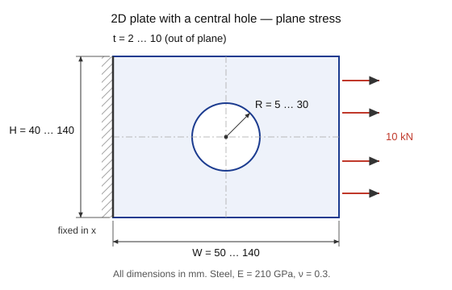
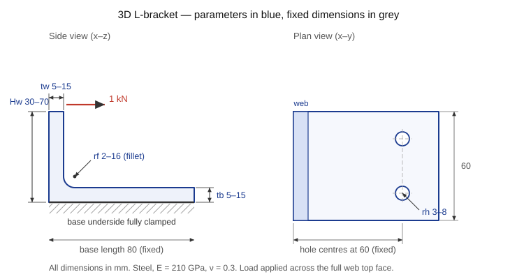

# FEA Surrogate Toolkit

Machine learning surrogates that predict structural stress and displacement in
**under a millisecond**, replacing finite element solves that take 0.15 s in 2D
and 8–50 s in 3D.

More than a single model: this is a **tool that builds surrogates**. Define a
part — your own geometry, loads and supports — choose which dimensions vary,
and it samples the design space, solves at every point, and trains a Gaussian
Process on the result.

Built as a self-directed project by **Mihir Rakshe**
(M.Sc. Robotics, AI, Automation and Industry 4.0, SRH University of Applied
Sciences Berlin).

---

## Contents

- [The problem](#the-problem)
- [Three layers](#three-layers)
- [Quick start](#quick-start)
- [Layer 1 — verified reference parts](#layer-1--verified-reference-parts)
- [Layer 2 — user-defined parts](#layer-2--user-defined-parts)
- [Layer 3 — the surrogate generator](#layer-3--the-surrogate-generator)
- [The application](#the-application)
- [Verification](#verification)
- [Repository contents](#repository-contents)
- [Running it](#running-it)
- [Limitations](#limitations)
- [Planned extensions](#planned-extensions)

---

## The problem

Finite element analysis is how engineers verify that a component is strong
enough. Its limitation is speed: a single analysis of an industrial part takes
minutes to hours, which puts simulation outside the interactive design loop.

The practical consequence is that engineers evaluate a handful of candidate
designs — however many fit the schedule — rather than exploring the design
space. Better designs are never assessed because nobody had time to look.

A surrogate model moves the computational cost upfront. Simulations are run in
advance across a sampled design space, a statistical model is trained on the
results, and subsequent predictions are effectively instantaneous. This is the
core method behind reduced-order modelling and executable digital twins.

**The constraint that shapes everything here:** a trained surrogate maps a
*fixed-length vector of numbers* to a result. Change the parameter list — add a
rib, move a hole, switch part family — and the model has nothing to predict
from. So a surrogate can never accept arbitrary geometry.

The way round it is not to make the model general, but to make the **part
definition** general. Once a user has defined their own parametric part, its
parameter vector is fixed, and a surrogate can be trained on it. That is what
this toolkit does.

---

## Three layers

| Layer | What it is | Geometry |
|---|---|---|
| **1. Reference parts** | Two hard-coded, independently verified pipelines | Fixed |
| **2. General solvers** | FEA driven by a part definition supplied as data | User-defined |
| **3. Generator** | Sweeps any design space and trains a surrogate on it | Either |

Each layer is verified against the one below it.

---

## Quick start

```bash
pip install gmsh scikit-fem meshio numpy scipy pandas scikit-learn matplotlib joblib streamlit
python simulate.py        # reference 2D solve; prints Kt ≈ 2.52
streamlit run app.py      # the full application
```

Tested on Python 3.12. Python 3.14 is not recommended — parts of the scientific
stack have not caught up with it.

---

## Layer 1 — verified reference parts

Two fixed pipelines, each verified against published data before any model was
trained. They exist to establish that the solver is correct, so the general
solvers above them have something to be checked against.

### 2D plate with a central hole



| Parameter | Symbol | Range | Unit |
|---|---|---|---|
| Plate width | `W` | 50 – 140 | mm |
| Plate height | `H` | 40 – 140 | mm |
| Hole radius | `R` | 5 – 30 | mm |
| Thickness | `t` | 2 – 10 | mm |

Plane stress, 10 kN tension along x, left edge constrained in x with one node
pinned in y. Steel, E = 210 GPa, ν = 0.3. Second-order triangles.

**Dataset:** 454 valid designs from 500 Latin Hypercube samples. 9.2% were
geometrically invalid — almost entirely cases where the hole radius exceeded
the available section — and these are logged with their parameters and reason
rather than silently dropped. The failure rate is a property of the sampling
domain worth reporting: the sampled box is not the same shape as the valid
design space.

| Target | Model | R² | nRMSE | Median error | Worst |
|---|---|---|---|---|---|
| Peak von Mises | Linear (baseline) | 0.746 | 6.75% | 15.55% | 54.3% |
| | **Gaussian Process** | **0.9959** | **0.86%** | **0.82%** | 26.0% |
| | Gradient boosting | 0.852 | 5.15% | 5.87% | 50.7% |
| Max displacement | Linear (baseline) | 0.684 | 7.03% | 16.04% | 58.2% |
| | **Gaussian Process** | **0.9982** | **0.52%** | **0.48%** | 15.3% |
| | Gradient boosting | 0.797 | 5.63% | 7.69% | 54.0% |

### 3D L-bracket with a fillet



| Parameter | Symbol | Range | Unit |
|---|---|---|---|
| Base plate thickness | `tb` | 5 – 15 | mm |
| Web thickness | `tw` | 5 – 15 | mm |
| Fillet radius | `rf` | 2 – 16 | mm |
| Web height | `Hw` | 30 – 70 | mm |
| Bolt hole radius | `rh` | 3 – 8 | mm |

Fixed: base length 80 mm, width 60 mm, bolt holes on centres at x = 60 mm.
Base underside fully clamped, 1 kN applied in +x across the top of the web.
Second-order tetrahedra.

This part was chosen deliberately. Extruding the 2D plate would have
reproduced the plane-stress answer and demonstrated nothing; **the fillet
stress concentration has no 2D equivalent.**

#### Choosing the right stress label

The global maximum von Mises stress sits at the **clamped edge**, not the
fillet. A fully-fixed boundary condition is mathematically singular at its
edge: refine the mesh and the stress climbs without converging. It is an
artefact of the idealised support, not a property of the part.

The pipeline therefore reports both. `max_vm_global` is recorded for
transparency; `max_vm_fillet` — the maximum over elements in the fillet region
— is the physically meaningful quantity and the one the surrogate is trained
on. Training on the global maximum would produce a model that accurately
predicts a mesh artefact.

| Target | Model | R² | nRMSE | Median error | Worst |
|---|---|---|---|---|---|
| Fillet von Mises | Linear (baseline) | 0.930 | 7.43% | 5.93% | 38.9% |
| | **Gaussian Process** | **0.9968** | **1.58%** | **1.22%** | 4.9% |
| | Gradient boosting | 0.785 | 13.01% | 16.59% | 58.2% |
| Max displacement | Linear (baseline) | 0.783 | 15.68% | 8.82% | 58.6% |
| | **Gaussian Process** | **1.0000** | **0.12%** | **0.26%** | 0.7% |
| | Gradient boosting | 0.893 | 11.00% | 18.31% | 73.2% |

#### Sensitivity: one parameter turned out to be dead weight

Permutation importance measures the R² lost when a parameter is shuffled.

| Parameter | R² lost (fillet stress) | R² lost (displacement) |
|---|---|---|
| `tw` web thickness | 1.298 | 1.046 |
| `Hw` web height | 0.602 | 1.123 |
| `rf` fillet radius | 0.453 | 0.059 |
| `tb` base thickness | 0.051 | 0.070 |
| `rh` **bolt hole radius** | **0.000** | **0.000** |

Bolt hole radius contributes nothing — zero to four decimal places, for both
targets. The holes sit far enough from the fillet that they are not in the load
path at all. A follow-up study should drop that dimension and spend the
simulation budget on the four that carry signal.

---

## Layer 2 — user-defined parts

The reference pipelines each hard-code one shape. `custom2d.py` and
`custom3d.py` take the geometry, loads and supports **as data**, so a user can
define their own part and still get a solve.

### The part definition

```json
{
  "name": "plate with a hole",
  "parameters": { "W": 100.0, "H": 100.0, "R": 10.0, "t": 5.0 },
  "outline":  [["0","0"], ["W","0"], ["W","H"], ["0","H"]],
  "holes":    [{ "x": "W/2", "y": "H/2", "r": "R" }],
  "thickness": "t",
  "segments": {
    "0": { "kind": "free" },
    "1": { "kind": "load",  "fx": 10000.0, "fy": 0.0 },
    "2": { "kind": "free" },
    "3": { "kind": "fixed", "dof": "xy" }
  }
}
```

Coordinates are **expressions in the parameters**, so one definition describes
a whole family of shapes — which is exactly what makes it possible to train a
surrogate on it afterwards. Segment *i* runs from outline point *i* to point
*i+1*, and that numbering is drawn on the preview so loads and supports can be
attached unambiguously.

### 3D extruded parts

`custom3d.py` extrudes the same profile along z. Faces are named
automatically: `side_0 … side_n` for the walls raised by each outline segment,
`bottom` and `top` for the caps, `hole_0 …` for bore walls. Each can carry its
own load or support.

```json
{
  "name": "Mounting plate",
  "kind": "extruded",
  "parameters": { "W": 120.0, "H": 60.0, "D": 10.0, "R": 8.0 },
  "outline": [["0","0"], ["W","0"], ["W","H"], ["0","H"]],
  "holes":   [{ "x": "W-25", "y": "H/2", "r": "R" }],
  "depth": "D",
  "faces": {
    "side_3": { "kind": "fixed", "dof": "xyz" },
    "side_1": { "kind": "load", "fx": 0.0, "fy": 0.0, "fz": -4000.0 }
  }
}
```

Loads are given as **total force in newtons**, divided internally by the face's
measured area — so the number entered is the force intended.

Seven worked examples are in `sample_parts/`.

### Expressions are parsed, not evaluated

Part definitions are data that may come from another person's file, so
expressions are walked with a restricted `ast` parser rather than `eval()`.
Only arithmetic, a short list of maths functions and the declared parameter
names are reachable. A part file cannot execute code.

---

## Layer 3 — the surrogate generator

`generator.py` takes ranges as an argument rather than hard-coding them. Give
it a design space and it runs the Latin Hypercube sweep, trains a Gaussian
Process per target, and stores the model **together with the ranges that
produced it** — so the application can refuse to predict outside the box the
model actually knows.

Three worked examples, all measured:

| Surrogate | Samples | Build time | GP R² (stress) | Linear baseline |
|---|---|---|---|---|
| Plate, narrowed box | 119 | 26 s | 0.9903 | 0.8830 |
| Cantilever beam (user-defined) | 80 | 7 s | 0.9998 | 0.9797 |
| L-shape, re-entrant corner (user-defined) | 70 | 12 s | 0.9993 | — |
| Tension strip, 3D extruded (user-defined) | 45 | 78 s | 0.9976 | — |

The linear baseline is kept deliberately. It establishes that the underlying
relationship is genuinely nonlinear, so the Gaussian Process result is
meaningful rather than impressive in isolation.

The Gaussian Process is the primary model not only because it is most accurate,
but because it returns a **predictive confidence interval** with every estimate
— it reports where it should not be trusted.

Sample count is suggested at roughly **100 points per input dimension**, which
is why cost scales sharply with the number of free parameters, and why active
learning is the obvious next step.

---

## The application

`streamlit run app.py` — three modes.

**Use a surrogate.** Sliders for every parameter, bounded to the trained range.
Instant prediction with a 95% confidence interval and the prediction time. A
yield check and safety factor against 250 MPa steel. A **Run FEA now** button
that solves the real model for the current geometry, reports the surrogate's
error against it with the measured speedup, and draws the full stress field.

That last feature is the point: the demonstrator shows its own error live
rather than asserting accuracy.

**Define a part.** Switch between **2D (plane stress)** and **3D (extruded
profile)**. Enter parameters, outline points and holes in tables; assign each
edge — or, in 3D, each face — a condition from a dropdown (`free`, `fixed`,
`load`), with force boxes appearing only for loads and hold directions only
for supports. The live preview numbers every segment; in 3D it shows the
profile beside the extruded solid, with fixed faces grey and loaded faces red.
Solve once for a heat map. Save and load parts as JSON.

**Create a surrogate.** Choose a built-in family or your own 2D or 3D part,
tick which parameters vary, set ranges, sample count and mesh size, and build. Progress bar with a
time estimate; accuracy table against the linear baseline when it finishes.

### Implementation notes worth knowing

- Gmsh must be initialised with `interruptible=False` when called from a
  Streamlit worker thread — its default SIGINT handler can only be installed
  from the main thread. Both solvers also clear leftover Gmsh state before
  initialising, so a failed run cannot poison a long-lived server process.
- Streamlit remembers widget contents by key across reruns. Loading a preset
  therefore had its edges silently overwritten by the previous state; the keys
  are versioned so a new part rebuilds the editor.
- Streamlit also keeps an uploaded file alive across reruns, so the "load
  this JSON" step ran on *every* interaction and reloaded the file over the
  user's edits. Each upload is now fingerprinted and processed once.
- Edge and face conditions use plain dropdowns rather than cells in an
  editable table, whose in-cell selector needs a second click to open.

---

## Verification

Every layer is checked against the one below it, and the solvers are checked
against published data. This section is the heart of the project.

### 1. Against published data

For a 100 × 100 mm plate with a 10 mm hole, the reference pipeline gives a
net-section stress concentration factor of **2.521**. Peterson's *Stress
Concentration Factors* gives approximately **2.51** — agreement better than
0.5%.

The 3D extruded solver, on a 100 × 50 mm strip with a 10 mm hole (d/W = 0.4),
gives **Kt = 2.09** where Peterson gives about 2.1.

### 2. Mesh convergence — 2D reference

| Refinement factor | Elements | Peak von Mises (MPa) | Kt |
|---|---|---|---|
| 4 | 794 | 61.47 | 2.459 |
| 6 | 1160 | 62.64 | 2.506 |
| 8 | 1599 | 63.02 | 2.521 |
| 12 | 2676 | 63.46 | 2.538 |
| 16 | 4027 | 63.81 | 2.552 |

Under 1.3% between the two finest meshes. Factor 8 adopted for dataset
generation: converged accuracy at ~0.15 s per solve.

### 3. Mesh convergence — 3D bracket

| Refinement factor | Elements | Fillet von Mises (MPa) | Kt | Solve time |
|---|---|---|---|---|
| 3 | 6,957 | 72.64 | 1.223 | 10.4 s |
| 4 | 12,503 | 74.26 | 1.251 | 38.4 s |

A 2.2% difference for 3.7× the solve time. Factor 3 was adopted, and **that
2.2% discretisation error is reported rather than described as converged** — it
is a real component of the dataset's uncertainty and sets a floor on achievable
surrogate accuracy.

### 4. Physical trend check — 3D bracket

A sharper fillet must concentrate stress more. Holding everything else fixed:

| Fillet radius `rf` (mm) | Kt at fillet |
|---|---|
| 2 | 1.290 |
| 4 | 1.223 |
| 6 | 1.083 |
| 10 | 0.952 |

Monotonic, and in the range expected for generous fillets.

### 5. General solver against the reference solver

The general 2D solver and the hard-coded one share no meshing or
boundary-condition code. On identical geometry, with matching supports and a
converged mesh:

| | Peak von Mises |
|---|---|
| Hard-coded pipeline | 63.021 MPa |
| General solver | 63.174 MPa |
| **Difference** | **0.24%** |

### 6. 3D extruded against 2D plane stress

The same plate solved two ways — as a 3D extrusion and as a 2D plane-stress
problem:

| | 3D extruded | 2D plane stress | Difference |
|---|---|---|---|
| Peak von Mises | 174.5 MPa | 184.1 MPa | 5.2% |
| Max displacement | 0.02939 mm | 0.02951 mm | **0.4%** |

The displacement agreement confirms the loads, supports and stiffness are
right. The stress gap is in-plane mesh resolution at the hole: a tet mesh is
much coarser in plane than a triangle mesh at comparable element count. The 3D
result is itself converged — 174.5 MPa at 3 mm against 175.0 at 2.2 mm, a 0.3%
change for 2.3× the elements.

### 7. Surrogate against its own solver

A surrogate trained on the user-defined L-shape, evaluated at the centre of its
design space: **predicted 8.20 MPa, true 8.06 MPa** — 1.7% error against a
solve it had never seen.

### Three bugs that verification caught

Recorded deliberately, because they are the argument for doing any of this.

**The singular support.** An early 2D version constrained the transverse degree
of freedom with a point predicate. `get_dofs()` in scikit-fem matches *facets*,
not points, so the constraint selected nothing and the part was free to
translate vertically. Stress was unaffected — it depends on gradients, and a
rigid translation has none — so the Peterson check passed and concealed it.
Displacement was wrong by up to a factor of **186**. Caught by comparing
against the hand calculation `F·W/(H·t·E)`.

**The lesson: the bug was in the only quantity that had not been independently
verified.**

**The face area.** The first 3D extruded solver computed face area incorrectly
and reported 5.8 MPa where hand calculation says ~180. Caught by checking `F/A`
on the net section.

**Mean versus max.** The heat map initially reduced element stress by `mean`
over quadrature points while the reported scalar used `max` — the same field,
summarised two ways, so the plotted peak read 59 MPa against a stated 63.02.
Now both use `max` and the circled peak equals the reported number exactly.

---

## Repository contents

| File | Purpose |
|---|---|
| `simulate.py` | Reference 2D pipeline — geometry, meshing, solution, post-processing |
| `sweep.py` | 2D Latin Hypercube sampling, batch execution, failure logging |
| `train.py` | 2D model training, comparison, error analysis, plots |
| `simulate3d.py` | Reference 3D L-bracket pipeline, with fillet-region stress extraction |
| `sweep3d.py` | 3D sampling and batch execution, with resume support |
| `train3d.py` | 3D training plus permutation sensitivity study |
| `custom2d.py` | General 2D plane-stress solver driven by a part definition |
| `custom3d.py` | General 3D solver for extruded profiles, per-face loads and supports |
| `generator.py` | Runtime sweep and training for any design space; model manifest |
| `plots.py` | Geometry drawings, part previews, 2D and 3D stress heat maps |
| `app.py` | Streamlit application — use, define, generate |
| `sample_parts/` | Seven worked part definitions, 2D and 3D |
| `docs/` | Dimensioned drawings of the reference parts |
| `dataset.csv`, `dataset3d.csv` | Reference datasets, including failure records |
| `metrics.json`, `metrics3d.json` | Full accuracy metrics for every model |
| `surrogate*.joblib` | Pre-trained reference models (~2 MB), so the app runs on clone |
| `models/` | Surrogates built in the app (git-ignored; rebuild from the UI) |

## Running it

```bash
pip install gmsh scikit-fem meshio numpy scipy pandas scikit-learn matplotlib joblib streamlit

# reference pipelines
python simulate.py            # single 2D solve, verifies Kt ≈ 2.52
python sweep.py               # dataset.csv (~1 min)
python train.py               # trains, writes plots and metrics

python simulate3d.py          # single 3D solve, ~8 s
python sweep3d.py --n 300     # dataset3d.csv (~40 min, resumable)
python train3d.py             # trains and runs the sensitivity study

# the application
streamlit run app.py
```

A user-defined part from Python:

```python
import json, custom2d
part = json.load(open("sample_parts/2d_cantilever_beam.json"))
r = custom2d.solve_part(part, return_field=True)
print(r["max_von_mises"], "MPa")
```

On Windows, if `streamlit` is not on PATH, use `python -m streamlit run app.py`.

The committed `.joblib` models are scikit-learn pickles. If they fail to load
under a different scikit-learn version, rerun `python train.py` and
`python train3d.py` to rebuild them from the committed datasets.

---

## Limitations

Stated explicitly rather than implied.

- **A surrogate is valid only inside its own design space.** Each model records
  the ranges it was trained on and the app enforces them. Extrapolation is not
  supported.
- **Geometry is polygons plus circular holes.** No splines or fillets in
  user-defined parts — a fillet needs arc support in the outline, which is a
  natural next step but is not there yet.
- **The 3D preview draws the outline and caps but not the holes**; the
  profile panel beside it shows them. The solver itself meshes the holes.
- **User-defined 3D means extruded profiles.** Arbitrary 3D geometry with
  arbitrary boundary conditions needs a CAD kernel and a face-picking GUI;
  that is out of scope for this project rather than half-built.
- **Linear elastic, single load case, small displacements** throughout. No
  contact, plasticity, buckling, thermal or dynamic effects.
- **The surrogates approximate the simulation, not physical reality.** They
  inherit every modelling assumption of the underlying FE model, including the
  idealised fully-clamped supports.
- **Worst-case error is far above the median** (26% against 0.82% for 2D
  stress). The largest errors occur at the edges of the training domain.
- **The 3D dataset carries ~2.2% discretisation error** from the chosen mesh
  refinement, which sets a floor on achievable surrogate accuracy.
- Intended for **design exploration and screening, not certification.**

## Planned extensions

- **Active learning** — use Gaussian Process uncertainty to choose the next
  simulations, improving accuracy per simulation over random sampling. This
  matters far more in 3D, where each sample costs seconds rather than
  milliseconds.
- Arc and fillet segments in user-defined outlines.
- Drop `rh` from the 3D bracket study and reinvest the budget in the four
  parameters that carry signal.
- Multiple and combined load cases.
- ONNX export with a C++ inference implementation, reflecting how surrogate
  models are deployed inside commercial CAD/CAE tools.
- An optimisation layer searching designs directly on the surrogate.

## Tools

Gmsh · scikit-fem · SciPy · NumPy · pandas · scikit-learn · Matplotlib ·
Streamlit · Git
